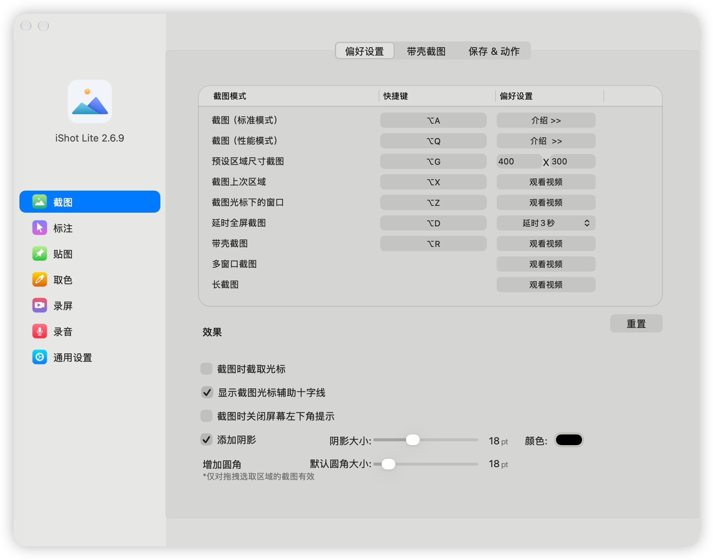

# iShot Lite

这是从 iShot 静态恢复材料重建并继续维护的 macOS 桌面应用。当前工程包含主应用、helper、组件源码、在用资源与依赖，以及本地构建、受控测试和 DMG 打包流程。它不是 DeepSeek 产品，也不承诺与原版完整等价。

应用目前面向 Apple Silicon（arm64），声明最低 macOS 12.3；使用 ad-hoc 签名，未公证。最低系统声明来自静态部署目标检查，不等于已在 macOS 12.3 实机验证。原版与 Lite 保留相同 bundle ID，不能同时运行，偏好及通知可能共享。

## 软件界面

实际软件的截图偏好设置页面，展示截图模式、快捷键与截图效果设置。

## 下载安装

从 [GitHub Releases](https://github.com/ponylabs/ishot-lite/releases) 下载 DMG，打开后将应用拖入 Applications。当前发布仅支持 Apple Silicon；签名与系统兼容限制见上文。

## 开始使用工程

先读 [开发说明](docs/development.md) 和 [测试说明](docs/testing.md)。常规构建入口为 `make -C reconstruction`；本地打包产物位于 `reconstruction/dist/`，不包含在源码检出中。验证或重新打包前保护既有产物，不把旧 JSON 报告当成新验证。

## 导航

- [架构与模块](docs/architecture.md)：源码、恢复材料和生成产物的边界。
- [开发约定](AGENTS.md)：Agent 的任务路由与项目约束。
- [文档约定](docs/AGENTS.md)：事实归属和生命周期。
- [恢复工程](reconstruction/README.md)：实现、模块契约与证据入口。
- [来源与许可](THIRD_PARTY_NOTICES.md)：harness 来源及原始材料的权利边界。

工程方法沿用 harness-seed 的 seek Skills、Notes 生命周期与验证入口。Skills 按任务读取；当前文档随实现原位更新，早期恢复材料归档在工程外；在用输入的来源仍保留，不因迁移变成独立原创。
